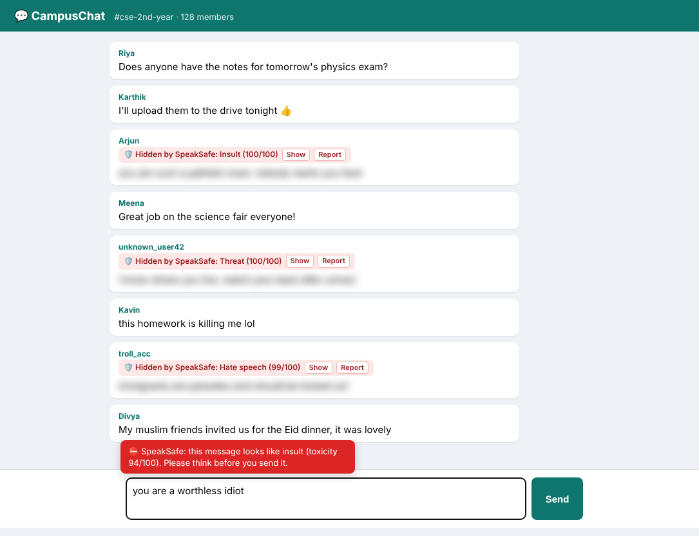

# 🛡️ SpeakSafe – Cyberbullying and Hate Speech Detection Platform

SpeakSafe reads text in your browser and detects **insults, threats and hate speech** in real time.

* While you **type**, it warns you before you send a hurtful message.
* On any **web page**, it blurs toxic comments and lets you **report** them.
* Every message gets a **toxicity score (0–100)** and a **category** (Safe, Insult, Threat, Hate speech).
* Moderators see flagged messages on a **dashboard**.

Built with **Java 17, Spring Boot, Apache OpenNLP, SQLite and a Chrome extension (HTML/CSS/JavaScript)**.



### ⚡ Quick start: just the Chrome extension (no Java needed)

1. Download **[SpeakSafe-Extension.zip](https://github.com/sundaresandharma-debug/Speaksafe/raw/main/dist/SpeakSafe-Extension.zip)** and unzip it.
2. Open Chrome (or Edge / Brave) and go to `chrome://extensions`.
3. Turn on **Developer mode** (top-right switch).
4. Click **Load unpacked** and choose the unzipped `SpeakSafe-Extension` folder.
5. Pin the 🛡️ icon from the puzzle-piece menu.

It works right away with its **built-in model**, the same trained SVM as the Java backend, exported to
`model.json` and run in the browser. If the Java backend is running, the extension uses it instead, and
flagged messages go to the moderator dashboard.

🎬 **Demo video (1 min 19 s):** [`docs/demo/SpeakSafe_Demo.mp4`](docs/demo/SpeakSafe_Demo.mp4)
· step-by-step screenshots in [`docs/demo/steps`](docs/demo/steps)

---

## How it works

```
User types / page shows text
        │
        ▼
Chrome extension (content.js) ──► background.js ──► Java backend  POST /api/analyze
                                        │  (no server?) ──► built-in model (speaksafe-model.js + model.json)
                                                        │
                       1. Preprocessing  (clean text, OpenNLP tokenizer + stemmer)
                       2. Feature extraction (TF-IDF on words and word pairs)
                       3. Classification (Linear SVM or Naive Bayes)
                       4. Score 0–100 + category (safe / insult / threat / hate speech)
                       5. Action: NONE / WARN / BLUR  (+ save flagged messages in SQLite)
                                                        │
Extension warns, blurs or reports  ◄────────────────────┘
```

| Module (from the project slides) | File |
|---|---|
| Input module | `controller/DetectionController.java`, `extension/content.js` |
| Preprocessing module | `nlp/TextPreprocessor.java` |
| Feature extraction module | `nlp/TfIdfVectorizer.java` |
| Classification module | `ml/NaiveBayesClassifier.java`, `ml/SvmClassifier.java` |
| Categorization module | `service/ToxicityDetector.java` |
| Action module | `service/ToxicityDetector.java`, `extension/content.js` |
| Database | `service/ReportRepository.java`, `resources/schema.sql` |
| Evaluation | `ml/ModelEvaluator.java` |
| Model export for the browser | `ml/ModelExporter.java`, `extension/speaksafe-model.js`, `extension/model.json` |

---

## Setup (about 10 minutes)

### 1. Install Java

Install **JDK 17 or newer** (for example from <https://adoptium.net>).
Check it in a terminal:

```
java -version
```

You do **not** need to install Maven, because the project includes the Maven wrapper (`mvnw`).

### 2. Start the backend

```
cd backend
./mvnw spring-boot:run          (Mac / Linux)
mvnw.cmd spring-boot:run        (Windows)
```

The first run downloads the libraries, which takes a few minutes. When you see
`SpeakSafe: trained Linear SVM on 1420 messages` and `Started SpeakSafeApplication`, it is ready.

Open <http://localhost:8080> to try the message checker and
<http://localhost:8080/dashboard.html> for the moderator dashboard.

### 3. Install the Chrome extension

1. Open Chrome and go to `chrome://extensions`
2. Turn on **Developer mode** (top right)
3. Click **Load unpacked** and select the `extension` folder
4. Pin the 🛡️ SpeakSafe icon. The popup should say **Connected to Java server**.

Now open any page with comments, or type something rude into any text box, and SpeakSafe reacts.
If the backend is not running, the popup says **Built-in model active** and everything still works.
Flagged messages are then listed on the extension's own page (popup → **Open flagged messages**).

After retraining (for example with a bigger dataset), copy the new model into the extension:

```
cd backend
java -jar target/speaksafe.jar --export-model ../extension/model.json
```

### 4. Run the demo yourself

The `demo` folder has a fake group-chat page ("CampusChat") with some toxic and some harmless messages.
Chrome extensions can't run on files opened directly from your disk unless you allow it, so serve the page
with any small web server. With Python installed:

```
cd demo
python -m http.server 8000
```

Then open <http://localhost:8000/chat.html> (backend running, extension installed) and try:

1. Watch the toxic messages get blurred. Click **Show**, **Hide** and **Report**.
2. Type `you are a worthless idiot` in the message box. A red warning appears.
3. Replace it with `sorry, I was upset. Can we talk after class?`. The warning goes away.
4. Press F12 → Console and run `incoming('anon', 'shut up you dumb idiot')`.
   The new message is blurred within a second.
5. Open the 🛡️ popup, then **Open moderator dashboard**.

### 5. Get the evaluation results (accuracy, precision, recall, F1)

```
cd backend
./mvnw package
java -jar target/speaksafe.jar --evaluate
```

This compares **Naive Bayes vs Linear SVM** on an 80/20 train/test split. Sample output is saved in
[`docs/evaluation_output.txt`](docs/evaluation_output.txt). The dashboard also has a **Run evaluation** button.

### 6. Run the tests

```
cd backend
./mvnw test
```

---

## REST API

| Method | URL | Body | Purpose |
|---|---|---|---|
| GET | `/api/health` | | Is the server running? |
| POST | `/api/analyze` | `{"text": "...", "sourceUrl": "...", "autoFlag": false}` | Score one message |
| POST | `/api/analyze/batch` | `{"texts": ["...", "..."], "sourceUrl": "...", "autoFlag": true}` | Score up to 50 messages |
| POST | `/api/report` | `{"text": "...", "sourceUrl": "..."}` | A user reports a message |
| GET | `/api/reports` | | List flagged/reported messages |
| DELETE | `/api/reports/{id}` | | Dismiss a report |
| GET | `/api/stats` | | Count of flagged messages per category |
| GET | `/api/evaluate` | | Naive Bayes vs SVM metrics |

Example response from `/api/analyze`:

```json
{
  "text": "I will beat you up after school",
  "score": 98,
  "category": "THREAT",
  "action": "BLUR",
  "probabilities": { "SAFE": 0.025, "INSULT": 0.016, "THREAT": 0.941, "HATE_SPEECH": 0.018 },
  "model": "Linear SVM"
}
```

## Settings

`backend/src/main/resources/application.properties`:

| Setting | Default | Meaning |
|---|---|---|
| `speaksafe.model` | `svm` | `svm` or `naive-bayes` |
| `speaksafe.warn-threshold` | `50` | Score at which a message gets a warning |
| `speaksafe.blur-threshold` | `70` | Score at which a message is blurred and flagged |

---

## About the dataset

`backend/src/main/resources/dataset/speaksafe_dataset.csv` has **1420 labelled messages**
(980 safe, 160 insult, 140 threat, 140 hate speech). It is built by `docs/make_dataset.py` from sentence
patterns plus about 250 hand-written everyday, news and anti-bullying sentences in
`docs/dataset_extra_safe.txt`. The format is simple:

```
label,text
insult,you are such a loser
safe,thanks for the notes
```

Most of it is generated from sentence patterns, so the 80/20 test-split accuracy (about 97–99%) is
**higher than you would get on real social media data**. A fairer check is
[`docs/demo/unseen_sentence_test.txt`](docs/demo/unseen_sentence_test.txt): 59 hand-written sentences the
model never saw: chat messages, article-style paragraphs and a news article about cyberbullying.
With the default Linear SVM, **73 of 74 harmless texts pass and 29 of 31 toxic ones are caught.** The one false
alarm is an article paragraph that *quotes* a threat. Naive Bayes raises 3 false alarms on the same text,
which is why SVM is the default. The mistakes are listed in the file. They make good material for the "results" and
"limitations" parts of your report.

To get more realistic numbers for your final report, add rows from a public dataset in the same
`label,text` format and re-run `--evaluate`. Good options:

* **Jigsaw Toxic Comment Classification** (Kaggle): map `insult` → insult, `threat` → threat,
  `identity_hate` → hate_speech, rows with no labels → safe
* **Cyberbullying Classification dataset** (Kaggle)
* **Davidson et al. Hate Speech and Offensive Language dataset** (GitHub)

Safe messages that mention religions, nationalities or groups are included on purpose, so the model learns
that naming a group is not hate speech by itself.

---

## Project report

[`docs/report/SpeakSafe_Project_Report.docx`](docs/report/SpeakSafe_Project_Report.docx) (and a PDF copy) is the full
project report in the college format: title page, bonafide and viva-voce certificates, abstract,
acknowledgement, contents, Chapters 1–6, source code appendix and references. The system diagrams
(architecture, flow, use case, class, sequence) are also in [`docs/report/diagrams`](docs/report/diagrams).

## Project report appendix (standalone)

[`docs/SpeakSafe_Appendix.docx`](docs/SpeakSafe_Appendix.docx) contains the full source code laid out like
the reference report's appendix (FILE STRUCTURE → MODULE 1 … MODULE 11 → SAMPLE OUTPUT with screenshots).
If you change the code, rebuild it with:

```
pip install python-docx
python3 docs/make_appendix.py
```

Screenshots for the report are in [`docs/screenshots`](docs/screenshots).

## Troubleshooting

| Problem | Fix |
|---|---|
| Popup says **Server offline** | Start the backend (step 2) and keep that terminal open |
| `Port 8080 already in use` | Close the other program or change `server.port` (and update `SERVER` in `extension/background.js` plus `host_permissions` in `manifest.json`) |
| Nothing is blurred | Reload the web page after installing the extension; check the switches in the popup |
| `java: invalid target release 17` | Install JDK 17 or newer |
